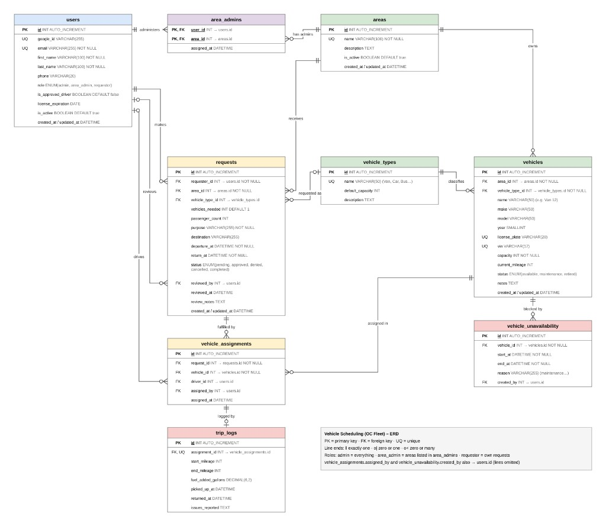

# Data Model Reference

**Status:** Feature 1 (`users`, `sessions`) and Feature 2 (`areas`, `area_admins`).

Update this file when a feature that defines schema merges to `dev`.

## Target ERD

The team's full Vehicle Scheduling (OC Fleet) model. Tables not listed under **Tables** below are planned by later features and do not exist yet.

Source image: [`docs/erd/vehicle-scheduling-erd.png`](../../docs/erd/vehicle-scheduling-erd.png). `sessions` is an auth table and is not drawn on the ERD.

## Tables

### `users` — Feature 1

| Column               | Type                                     | Rules                                               |
| -------------------- | ---------------------------------------- | --------------------------------------------------- |
| `id`                 | INTEGER PK                               | Auto-increment                                      |
| `google_id`          | STRING(255)                              | Unique; null until first sign-in (seeded users)     |
| `email`              | STRING(255)                              | Required, unique; stored trimmed + lowercase        |
| `first_name`         | STRING(100)                              | Required; trimmed                                   |
| `last_name`          | STRING(100)                              | Required; trimmed                                   |
| `phone`              | STRING(20)                               | Optional                                            |
| `role`               | ENUM(`admin`, `area_admin`, `requestor`) | Required; default `requestor`                       |
| `is_approved_driver` | BOOLEAN                                  | Default `false`                                     |
| `license_expiration` | DATEONLY                                 | Optional; required when `is_approved_driver` true   |
| `is_active`          | BOOLEAN                                  | Default `true`                                      |
| `created_at`         | DATE                                     | Sequelize timestamps                                |
| `updated_at`         | DATE                                     | Sequelize timestamps                                |

Model: `backend/app/models/user.model.js`. `defaultScope` excludes `google_id`; use `db.user.unscoped()` to read it.

### `sessions` — Feature 1

| Column            | Type       | Rules                                             |
| ----------------- | ---------- | ------------------------------------------------- |
| `id`              | INTEGER PK | Auto-increment                                    |
| `token`           | STRING     | Required; set to `""` on sign-out                 |
| `email`           | STRING     | Required                                          |
| `expiration_date` | DATE       | Required; 24 hours after creation                 |
| `user_id`         | INTEGER FK | Required, references `users.id` (cascade delete)  |
| `created_at`      | DATE       | Sequelize timestamps                              |
| `updated_at`      | DATE       | Sequelize timestamps                              |

Model: `backend/app/models/session.model.js`.

### `areas` — Feature 2

| Column        | Type        | Rules                                              |
| ------------- | ----------- | -------------------------------------------------- |
| `id`          | INTEGER PK  | Auto-increment                                     |
| `name`        | STRING(100) | Required, trimmed, unique. API also rejects another casing of an existing name. |
| `description` | TEXT        | Optional                                           |
| `is_active`   | BOOLEAN     | Default `true`                                     |
| `created_at`  | DATE        | Sequelize timestamps                               |
| `updated_at`  | DATE        | Sequelize timestamps                               |

Model: `backend/app/models/area.model.js`.

### `area_admins` — Feature 2

| Column        | Type           | Rules                                      |
| ------------- | -------------- | ------------------------------------------ |
| `user_id`     | INTEGER PK, FK | References `users.id`, `ON DELETE CASCADE` |
| `area_id`     | INTEGER PK, FK | References `areas.id`, `ON DELETE CASCADE` |
| `assigned_at` | DATE           | Required; defaults to now                  |

Composite primary key (`user_id`, `area_id`). No `created_at` / `updated_at`.

Model: `backend/app/models/areaAdmin.model.js`.

## Associations

Defined in `backend/app/models/index.js`:

- `User hasMany Session` (`userId`)
- `Session belongsTo User` (`userId`, alias `user`)
- `User belongsToMany Area` through `area_admins` (`userId`, alias `managedAreas`)
- `Area belongsToMany User` through `area_admins` (`areaId`, alias `admins`)
