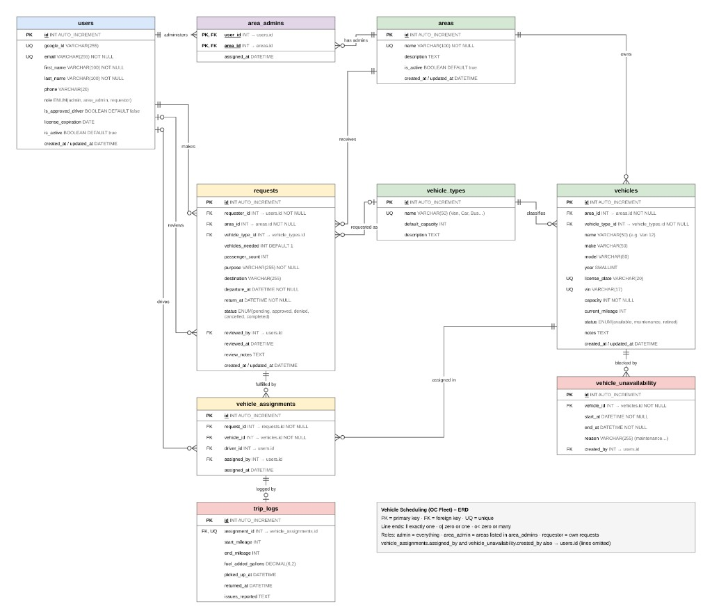

# Data Model Reference

**Status:** Feature 1 (`users`, `sessions`), Feature 3 (`vehicle_types`, `areas`, `area_admins`, `vehicles`, `vehicle_unavailability`), Feature 4 (`requests`), Feature 5 (`destinations`, `vehicle_assignments`, `requests.destination_id`), and Feature 6 (`trip_logs` checkout fields, calendar and dashboard reads).

Update this file when a feature that defines schema merges to `dev`.

## Target ERD

The team's full Vehicle Scheduling (OC Fleet) model. Tables not listed under **Tables** below are planned by later features and do not exist yet.

Source image: [`docs/erd/vehicle-scheduling-erd.png`](../../docs/erd/vehicle-scheduling-erd.png). `sessions` is an auth table and is not drawn on the ERD.

## Tables

### `users` — Feature 1

| Column               | Type                                     | Rules                                               |
| -------------------- | ---------------------------------------- | --------------------------------------------------- |
| `id`                 | INTEGER PK                               | Auto-increment                                      |
| `google_id`          | STRING(255)                              | Unique; null until first sign-in (seeded users)     |
| `email`              | STRING(255)                              | Required, unique; stored trimmed + lowercase        |
| `first_name`         | STRING(100)                              | Required; trimmed                                   |
| `last_name`          | STRING(100)                              | Required; trimmed                                   |
| `phone`              | STRING(20)                               | Optional                                            |
| `role`               | ENUM(`admin`, `area_admin`, `requestor`) | Required; default `requestor`                       |
| `is_approved_driver` | BOOLEAN                                  | Default `false`                                     |
| `license_expiration` | DATEONLY                                 | Optional; required when `is_approved_driver` true   |
| `is_active`          | BOOLEAN                                  | Default `true`                                      |
| `created_at`         | DATE                                     | Sequelize timestamps                                |
| `updated_at`         | DATE                                     | Sequelize timestamps                                |

Model: `backend/app/models/user.model.js`. `defaultScope` excludes `google_id`; use `db.user.unscoped()` to read it.

### `sessions` — Feature 1

| Column            | Type       | Rules                                             |
| ----------------- | ---------- | ------------------------------------------------- |
| `id`              | INTEGER PK | Auto-increment                                    |
| `token`           | STRING     | Required; set to `""` on sign-out                 |
| `email`           | STRING     | Required                                          |
| `expiration_date` | DATE       | Required; 24 hours after creation                 |
| `user_id`         | INTEGER FK | Required, references `users.id` (cascade delete)  |
| `created_at`      | DATE       | Sequelize timestamps                              |
| `updated_at`      | DATE       | Sequelize timestamps                              |

Model: `backend/app/models/session.model.js`.

### `vehicle_types`

| Column | Notes |
|--------|--------|
| `name` | Required, unique, compared case-insensitively |
| `description` | Optional |
| `default_passenger_capacity` | Optional integer 1–30 |
| `is_active` | Default `true` |

### `areas` / `area_admins`

Area name, description, and `is_active`. `area_admins` pairs a user with an area. Feature 2 owns writing these rows. This branch reads them through `getManagedAreaIds`.

### `vehicles`

One vehicle belongs to one area and one vehicle type. `status` is `available`, `maintenance`, or `retired`. `displayName` is computed: the name when it is set, otherwise year, make, and model.

### `vehicle_unavailability`

A dated block on one vehicle: `starts_at`, `ends_at`, `reason`, and `created_by`. It does not change `status`.

### `requests` — Feature 4

| Column | Type | Rules |
|--------|------|-------|
| `id` | INTEGER PK | Auto-increment |
| `requester_id` | INTEGER FK | Required; references `users.id`; set from the session |
| `area_id` | INTEGER FK | Required; references `areas.id`; area must be active on create and update |
| `vehicle_type_id` | INTEGER FK | Required; references `vehicle_types.id`; type must be active on create and update |
| `vehicles_needed` | INTEGER | Required; default `1`; at least 1 |
| `passenger_count` | INTEGER | Required; at least 1 |
| `purpose` | STRING(255) | Required; trimmed; not blank |
| `destination` | STRING(255) | Required; trimmed; not blank. Kept so Feature 4 request create and edit still store a destination string |
| `destination_id` | INTEGER FK NULL | Optional; references `destinations.id`. Review responses use the destination name when this is set |
| `departure_at` | DATETIME | Required; must be after the server time on create and update |
| `return_at` | DATETIME | Required; must be after `departure_at` |
| `status` | ENUM | `pending`, `approved`, `denied`, `cancelled`, `completed`; default `pending` |
| `reviewed_by` | INTEGER FK NULL | References `users.id`; written by Feature 5 |
| `reviewed_at` | DATETIME NULL | Written by Feature 5 |
| `review_notes` | TEXT NULL | Written by Feature 5 |
| `created_at` | DATETIME | Sequelize timestamps |
| `updated_at` | DATETIME | Sequelize timestamps |

Model: `backend/app/models/request.model.js`. Feature 4 still writes the `destination` string. Feature 5 adds `destination_id` and writes `status`, `reviewed_by`, `reviewed_at`, and `review_notes`.

### `destinations` — Feature 5

| Column | Type | Rules |
|--------|------|-------|
| `id` | INTEGER PK | Auto-increment |
| `name` | STRING(255) | Required; trimmed; unique ignoring case |
| `is_active` | BOOLEAN | Default `true` |
| `created_at` | DATETIME | Sequelize timestamps |
| `updated_at` | DATETIME | Sequelize timestamps |

Model: `backend/app/models/destination.model.js`. There is no delete.

### `vehicle_assignments` — Feature 5

| Column | Type | Rules |
|--------|------|-------|
| `id` | INTEGER PK | Auto-increment |
| `request_id` | INTEGER FK | Required; references `requests.id` |
| `vehicle_id` | INTEGER FK | Required; references `vehicles.id` |
| `driver_id` | INTEGER FK NULL | Optional; references `users.id` |
| `assigned_by` | INTEGER FK | References `users.id`; set from the session |
| `assigned_at` | DATETIME | Set on create and update |

Unique index on (`request_id`, `vehicle_id`). Index on `vehicle_id`. Sequelize `timestamps: false`. No database overlap constraint. Model: `backend/app/models/vehicleAssignment.model.js`.

### `trip_logs` — Feature 5 and Feature 6

| Column | Type | Rules |
|--------|------|-------|
| `id` | INTEGER PK | Auto-increment |
| `assignment_id` | INTEGER FK | Required; unique; references `vehicle_assignments.id`. One log per assignment |
| `start_mileage` | INTEGER | Required. Set on check-out, and still required when Feature 5 completes a request |
| `end_mileage` | INTEGER NULL | Null until check-in. On check-in, greater than or equal to `start_mileage`. Feature 5 complete still requires it |
| `fuel_added_gallons` | DECIMAL(8,2) NULL | Optional on check-in |
| `picked_up_at` | DATETIME | Set on check-out |
| `returned_at` | DATETIME NULL | Null until check-in |
| `issues_reported` | TEXT NULL | Optional on check-in |
| `created_at` | DATETIME | Sequelize timestamps |
| `updated_at` | DATETIME | Sequelize timestamps |

Model: `backend/app/models/tripLog.model.js`. Feature 6 check-out inserts the row. Feature 6 check-in fills the return fields and sets `vehicles.current_mileage` to `end_mileage`. Feature 5 complete still inserts a finished log in one step.

## Associations

Defined in `backend/app/models/index.js`:

- `User hasMany Session` (`userId`, cascade delete)
- `Session belongsTo User` (`userId`, alias `user`)
- `User` belongsToMany `Area` through `AreaAdmin` (alias `managedAreas` / `admins`)
- `Area` hasMany `Vehicle`
- `Vehicle` belongsTo `Area` and `VehicleType`
- `Vehicle` hasMany `VehicleUnavailability`
- `VehicleUnavailability` belongsTo `Vehicle`
- `VehicleUnavailability` belongsTo `User` (`createdBy`)
- `User` hasMany `Request` (`requesterId`, alias `requests`)
- `Request` belongsTo `User` as `requester` (`requesterId`) and as `reviewer` (`reviewedBy`)
- `Area` hasMany `Request`; `Request` belongsTo `Area`
- `VehicleType` hasMany `Request`; `Request` belongsTo `VehicleType`
- `Destination` hasMany `Request` (`destinationId`); `Request` belongsTo `Destination` as `destinationRecord` (the `destination` string column keeps that name)
- `Request` hasMany `VehicleAssignment` (`as: 'assignments'`); `VehicleAssignment` belongsTo `Request`
- `Vehicle` hasMany `VehicleAssignment`; `VehicleAssignment` belongsTo `Vehicle`
- `VehicleAssignment` belongsTo `User` as `driver` (`driverId`) and as `assigner` (`assignedBy`)
- `VehicleAssignment` hasOne `TripLog` (`as: 'tripLog'`); `TripLog` belongsTo `VehicleAssignment`
